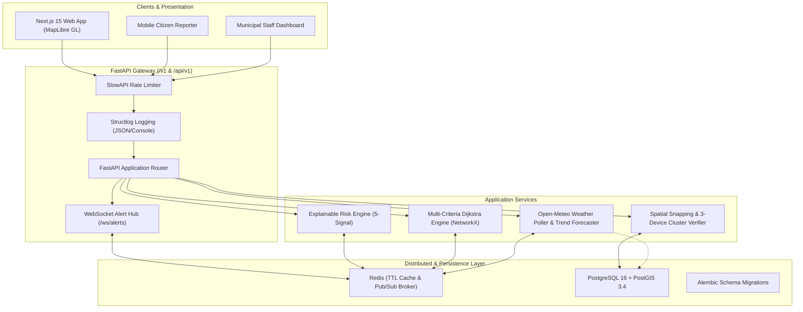

# Flood-Aware Route & Road Risk Engine (Pune, Maharashtra)

An explainable, multi-criteria flood-risk navigation and municipal management platform for Pune. It computes real-time road segment hazard scores by combining high-resolution terrain indicators, live Open-Meteo precipitation signals, calibrated historical flood hotspots, drainage buffer distances, and verified crowd reports.

---

## 1. System Architecture



---

## 2. Core Methodologies & Algorithms

### 2.1 Explainable 5-Signal Risk Formulation

Every road segment is scored on a continuous scale $[0.0, 1.0]$ with full factor transparency:

$$R_{\text{seg}} = w_{\text{terrain}} \cdot s_{\text{terrain}} + w_{\text{rainfall}} \cdot s_{\text{rainfall}} + w_{\text{history}} \cdot s_{\text{flood\_history}} + w_{\text{drainage}} \cdot s_{\text{drainage}} + w_{\text{crowd}} \cdot s_{\text{crowd}}$$

Weights are versioned in `models/risk_engine/v1/risk_weights.yaml` and validated against Pune hotspot labels (`calibrate_weights.py`):
- **Terrain** ($w = 0.25$): Mean elevation, slope percentage, and sink depression index.
- **Rainfall Pressure** ($w = 0.35$): Dynamic response function using segment threshold $T_{\text{seg}}$:
  $$s_{\text{rainfall}} = \max\left(0, \min\left(1, \frac{I - 0.5 \cdot T_{\text{seg}}}{1.5 \cdot T_{\text{seg}}}\right)\right)$$
- **Flood History** ($w = 0.20$): Calibrated distance decay to 40 verified Pune flood hotspots.
- **Drainage** ($w = 0.10$): Proximity to primary stormwater canals, nallahs, and rivers.
- **Citizen Crowd** ($w = 0.10$): Scaled by verified reports ($s_{\text{crowd}} = \min(1.0, \text{count}/3)$).

#### Risk Bands & Guardrails
- **Low (0.00 – 0.34)**: Safe for all vehicles.
- **Moderate (0.35 – 0.54)**: Caution for low-clearance vehicles.
- **High (0.55 – 0.74)**: Significant waterlogging; avoid for two-wheelers.
- **Severe (0.75 – 1.00)**: Impassable; automated avoidance penalty in routing.
- **Dry-Day Guardrail**: If rainfall $< 1.0\text{ mm/h}$, unverified reports cannot raise segment risk above $0.40$.

---

### 2.2 Risk-Aware Dijkstra Routing

Computes 3 concurrent Pareto routes over a directed graph constructed from Pune road geometry:

$$\text{Cost}(e) = t_{\text{base}} \cdot \left(1 + \lambda_{\text{pref}} \cdot R_{\text{effective}}(e)\right) + \text{Penalty}(e)$$

- **Fast Route ($\lambda = 0.0$)**: Minimizes travel time exclusively.
- **Safe Route ($\lambda = 5.0$)**: Applies a severe penalty ($+1000\text{ min}$) to any edge exceeding the vehicle's safe flood threshold (`avoid_at`).
- **Balanced Route ($\lambda = 1.5$)**: Trades off flood avoidance with minimal travel time detour.

---

### 2.3 Crowd Verification & Municipal Escalation

- **3-Device Auto-Verification Rule**: If $\ge 3$ distinct device fingerprints submit reports within $150\text{ m}$ in a $30\text{-minute}$ rolling window, all reports automatically transition from `pending` to `verified`.
- **Photo Upload Verification**: Strict validation on `POST /v1/reports/photo` enforcing $\le 3\text{ MB}$, magic byte checks (JPEG/PNG/WebP), and secure UUID-renamed filesystem storage.
- **Municipal Work Orders**: Full lifecycle dispatch (`open` $\to$ `assigned` $\to$ `in_progress` $\to$ `resolved`). Resolving a work order automatically resolves linked citizen reports and clears the road's crowd hazard score.
- **Drainage Failure Detection**: Detects segments flooding under moderate rainfall ($8\text{--}15\text{ mm/h}$) despite low historical risk ($s_{\text{hist}} \le 0.40$), indicating localized drainage blockages.

---

## 3. Technology Stack

- **Backend**: FastAPI 0.115, Python 3.13, NetworkX 3.2, Shapely 2.0, Psycopg 3.2, Uvicorn.
- **Database & Spatial**: PostgreSQL 16 + PostGIS 3.4, Alembic 1.20 migrations.
- **Caching & Broker**: Redis 7 / 8 (Pub/Sub alerts, 30s GeoJSON cache, 60s route cache).
- **Security & Limits**: PyJWT (HS256 staff auth), SlowAPI rate limiting (in-memory + Redis store).
- **Observability**: Structlog structured logging (JSON in production, coloured console in development).
- **Testing**: Pytest 9, Schemathesis 4 (property-based contract tests), Locust 2 (load testing).
- **Frontend**: Next.js 15 (App Router), React 19, TypeScript 5.7, MapLibre GL, Tailwind CSS, Zustand.

---

## 4. Quickstart Guide

### Option A: Docker Compose (Recommended)

```bash
# 1. Clone & copy environment settings
git clone https://github.com/khushi-596/Flood_Risk.git
cd Flood_Risk
cp .env.example .env

# 2. Build and launch services (FastAPI, Next.js, PostGIS, Redis)
docker compose up --build
```
- Map UI: `http://localhost:3000`
- Interactive API Docs: `http://localhost:8000/docs`

---

### Option B: Local Python Development

```bash
# 1. Create and activate virtual environment
python -m venv .venv
source .venv/bin/activate       # Linux/macOS
.\.venv\Scripts\Activate.ps1    # Windows PowerShell

# 2. Install dependencies
pip install -r services/api/requirements.txt

# 3. Run database migrations (when PostgreSQL is running)
alembic upgrade head

# 4. Ingest and calibrate offline datasets
make data

# 5. Start development API server
uvicorn app.main:app --app-dir services/api --reload --port 8000
```

---

## 5. API Reference & Prefix Support

All routes are mounted under both the primary `/v1` prefix and the spec-compliant `/api/v1` alias.

| Method | Endpoint | Auth | Rate Limit | Description |
| :--- | :--- | :--- | :--- | :--- |
| `GET` | `/v1/health` | Public | 120/min | System liveness and version info |
| `GET` | `/v1/health/ready` | Public | 120/min | Deep readiness probe checking PostgreSQL & Redis connectivity |
| `GET` | `/v1/segments` | Public | 120/min | Risk-scored GeoJSON FeatureCollection (cached 30s) |
| `GET` | `/v1/segments/{id}/explanation`| Public | 120/min | 5-signal risk breakdown and weighted factors |
| `POST` | `/v1/routes/compare` | Public | 30/min | Fast, Safe, Balanced Dijkstra routes (cached 60s) |
| `GET/POST`| `/v1/travel-advice` | Public | 60/min | "Should I Travel Now?" Go/Caution/Wait/Avoid advice |
| `GET` | `/v1/rain` | Public | 120/min | Live rainfall and 30m trend projection |
| `POST` | `/v1/rain/simulate` | Public | 30/min | Rain simulator override (`none` $\to$ `extreme` or custom mm/h) |
| `GET` | `/v1/rain/playback` | Public | 60/min | 3-hour storm playback sequence definition |
| `POST` | `/v1/rain/playback/{step}` | Public | 30/min | Seek storm playback step (0 to 6) |
| `POST` | `/v1/reports` | Public | 30/min | Submit citizen report (nearest segment snap) |
| `POST` | `/v1/reports/photo` | Public | 20/min | Upload hazard photo ($\le 3\text{ MB}$, JPEG/PNG/WebP) |
| `GET` | `/v1/reports` | Public | 60/min | Get citizen's own reports by device fingerprint |
| `POST` | `/v1/municipal/login` | Public | 20/min | Staff login returning JWT access token |
| `GET` | `/v1/municipal/reports` | Staff Bearer | 60/min | Triage queue of pending citizen reports |
| `POST` | `/v1/municipal/reports/{id}/review`| Staff Bearer | 60/min | Review report (`verified` or `rejected`) |
| `GET` | `/v1/municipal/hotspots` | Staff Bearer | 60/min | Active flood hotspots with $\ge 2$ reports |
| `GET` | `/v1/municipal/drain-failure-flags`| Staff Bearer | 60/min | Blocked culvert / drain failure indicators |
| `GET/POST`| `/v1/municipal/work-orders` | Staff Bearer | 60/min | Municipal work orders creation & listing |
| `PATCH`| `/v1/municipal/work-orders/{id}` | Staff Bearer | 60/min | Update work order status (`open` $\to$ `resolved`) |
| `GET` | `/v1/municipal/reports.csv` | Staff Bearer | 20/min | Download CSV report export |
| `WS` | `/v1/ws/alerts` | Public | None | Real-time WebSocket alerts for High/Severe risk transitions |

---

## 6. Testing, Resilience & Verification

### Test Suite Execution

```bash
# Run all 86 tests (zero running database or Redis required)
pytest services/api/tests -v

# Run 5 Pune Origin-Destination benchmark suite
pytest services/api/tests/test_od_benchmarks.py -v

# Run Schemathesis contract & schema conformance tests
pytest services/api/tests/test_contract.py -v

# Run failure-mode & graceful degradation tests
pytest services/api/tests/test_failure_modes.py -v

# Run self-contained Locust load test benchmark
python -m tests.load.run_load_test --host http://127.0.0.1:8000 --users 15 --duration 15
```

Detailed test documentation:
- [1-Page Test Summary](docs/test_summary.md)
- [Load Test Performance Report](tests/load/load_test_report.md)
- [Crowd-Sourced Reporting Specification](docs/crowd-spec.md)
- [Data Quality Report](data/data_quality_report.md)


---

## 7. Render Deployment

This project includes a [`render.yaml`](render.yaml) Blueprint for one-click deployment.

### One-Click Deploy

1. Push this repo to GitHub
2. Go to [https://dashboard.render.com](https://dashboard.render.com) → **New** → **Blueprint**
3. Connect your GitHub repo and select the branch
4. Render reads `render.yaml` and creates:
   - **flood-risk-db** — PostgreSQL 16 (free tier)
   - **flood-risk-api** — FastAPI backend (Docker)
   - **flood-risk-web** — Next.js frontend (Docker)
5. Set `NEXT_PUBLIC_API_BASE_URL` to your API's Render URL (e.g. `https://flood-risk-api.onrender.com/v1`)
6. Update `CORS_ORIGINS` on the API to include your frontend URL

### Environment Variables

| Service | Variable | Value |
|---------|----------|-------|
| API | `DATABASE_URL` | Auto-set by Render from database binding |
| API | `JWT_SECRET` | Auto-generated by Render |
| API | `CORS_ORIGINS` | Your frontend URL (comma-separated) |
| Web | `NEXT_PUBLIC_API_BASE_URL` | Your API URL + `/v1` |
| Web | `NEXT_PUBLIC_MAP_STYLE_URL` | `https://demotiles.maplibre.org/style.json` |

### Manual Deploy (without Blueprint)

```bash
# API service
# Runtime: Docker | Dockerfile: services/api/Dockerfile | Docker context: .
# Health check: /v1/health

# Web service  
# Runtime: Docker | Dockerfile: apps/web/Dockerfile | Docker context: apps/web
```
